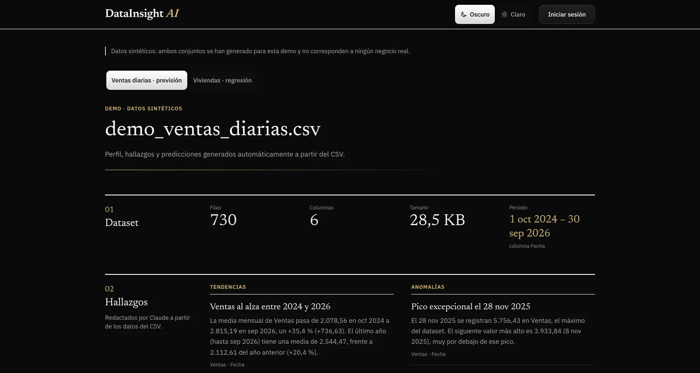

# DataInsight AI

Plataforma web que convierte un CSV en visualizaciones interactivas, insights en lenguaje natural y predicciones automáticas mediante IA y ML, sin escribir una línea de código.

App: https://data-insight-ai-qbh4.vercel.app · Demo sin registro: https://data-insight-ai-qbh4.vercel.app/demo



## Funcionalidades

- **Perfilado automático** — tipos de columnas, nulos, outliers, estadísticos descriptivos, cardinalidad y el **periodo** de fechas del dataset (por ejemplo, «1 oct 2024 – 30 sep 2026»)
- **Gráficos adaptados a los datos** — histogramas con intervalos dentro del rango intercuartílico y barras aparte para los outliers; una barra por valor en columnas discretas; serie temporal; heatmap de correlaciones con 3 o más columnas numéricas; dispersión solo entre columnas continuas correlacionadas. Se omiten las columnas identificador y las categóricas casi uniformes
- **Hallazgos con LLM** — tendencias, anomalías, correlaciones y recomendaciones redactados por Claude (Anthropic). El modelo recibe un resumen de los datos con un apartado **por año** (medias, máximos y mínimos), y cada cifra de un hallazgo se valida contra ese resumen: si alguna no aparece, el hallazgo se descarta
- **Previsión** — Holt-Winters (statsmodels) cuando hay columna de fecha, con el horizonte según la frecuencia (30 días, 12 semanas, 12 meses…), **intervalo del 95 %** y error medido en un backtest (**WAPE** y **MAE**)
- **Regresión** — si no hay previsión, RandomForest con R², RMSE e importancia de variables; las columnas identificador no se usan como objetivo ni como variables
- **Informe PDF** — resumen del dataset, perfil de columnas, hallazgos y métricas de predicción
- **Tema oscuro y claro** — oscuro por defecto, con selector en todas las páginas
- **Accesibilidad** — sin animaciones con `prefers-reduced-motion`, foco visible, heatmap con alternativa de texto, errores anunciados con `role="alert"` y controles con etiquetas accesibles
- **Demo pública** — dos análisis precalculados sobre datos sintéticos (ventas diarias con previsión, viviendas con regresión), sin registro. La raíz de la app lleva al login, que tiene el botón «Ver la demo sin registrarte»

## Arranque rápido

### Requisitos

- [Docker](https://docs.docker.com/get-docker/) + Docker Compose v2

### Con Docker (recomendado)

```bash
# 1. Clona el repo
git clone <repo-url>
cd DataInsightAI

# 2. Crea los .env con tus claves
cp apps/api/.env.example apps/api/.env
cp apps/web/.env.example apps/web/.env.local
# Edita ambos archivos con tus credenciales de Supabase y Anthropic

# 3. Levanta todo
docker compose up --build

# Servicios disponibles:
#   web  → http://localhost:3000
#   api  → http://localhost:8000/docs
```

### Usuario de los contenedores

Los contenedores no corren como root, así que los ficheros que crean en tu carpeta (por ejemplo `.next/`) son tuyos:

- **api y worker**: usuario `app`, con UID y GID 1000.
- **web**: usuario `node` de la imagen oficial de Node, con UID y GID 1000. No se puede cambiar al construir.

Si tu usuario no tiene el UID 1000 (`id -u`), construye la API con el tuyo:

```bash
docker compose build --build-arg APP_UID=$(id -u) --build-arg APP_GID=$(id -g) api worker
```

Después levanta con `docker compose up` sin `--build`: `--build` volvería a construir con el UID 1000.

Si antes levantaste el proyecto con contenedores que corrían como root:

- Los volúmenes que llenaron siguen siendo de root y hay que recrearlos. Por ejemplo: `docker compose down` y después `docker volume rm datainsightai_web_node_modules`. No uses `docker compose down -v`, que borra también la base de datos local.
- Los ficheros de root que dejaron en tu carpeta también: `.next/` se puede borrar, porque se regenera.

### Variables de entorno

**`apps/api/.env`**
| Variable | Descripción |
|---|---|
| `ANTHROPIC_API_KEY` | API key de [console.anthropic.com](https://console.anthropic.com) |
| `SUPABASE_URL` | URL del proyecto Supabase. Obligatoria y con `https://`: sin ella la API no arranca |
| `SUPABASE_SERVICE_ROLE_KEY` | Service role key (Settings → API) |
| `DATABASE_URL` | Conexión PostgreSQL (usar Supabase en prod) |
| `REDIS_URL` | Conexión Redis |
| `STORAGE_BUCKET` | Bucket de Supabase Storage donde se guardan los CSV subidos (por defecto `datasets`) |
| `CORS_ORIGINS` | Orígenes que pueden llamar a la API: lista separada por comas (`https://app.example.com,http://localhost:3000`) o array JSON (`["http://localhost:3000"]`). Cada origen se compara literalmente: con esquema, sin barra final y sin comodines (`https://*.vercel.app` no funciona). Vacía, solo `http://localhost:3000` |

**`apps/web/.env.local`**
| Variable | Descripción |
|---|---|
| `NEXT_PUBLIC_SUPABASE_URL` | URL del proyecto Supabase |
| `NEXT_PUBLIC_SUPABASE_ANON_KEY` | Anon/public key (Settings → API) |
| `NEXT_PUBLIC_API_URL` | URL de la API (`http://localhost:8000` en local) |

## Tests y CI

- **API** — pytest, 369 tests en `apps/api/tests/`. Los servicios externos (Anthropic, Supabase Storage, Celery) se sustituyen por mocks.
- **Web** — Vitest con Testing Library y jsdom, 118 tests junto a los componentes y módulos que prueban.

```bash
docker compose run --rm api pytest tests/ -v   # API
cd apps/web && npm test                        # web
```

En cada pull request contra `main` y en cada push a `main`, GitHub Actions (`.github/workflows/ci.yml`) ejecuta dos jobs:

- **api** — con un PostgreSQL 16 de servicio: instala dependencias con `uv sync --locked`, `ruff check` y `pytest`.
- **web** — `npm ci`, typecheck (`tsc --noEmit`), lint (ESLint), tests (Vitest) y `next build`.

## Arquitectura

```
DataInsightAI/
├── apps/
│   ├── api/                  # FastAPI — procesamiento, ML, LLM
│   │   ├── app/
│   │   │   ├── routers/      # projects, datasets, analyses
│   │   │   ├── services/     # profiling, insights_llm, insights_check, forecasting, ml_baseline, report
│   │   │   ├── workers/      # Celery tasks
│   │   │   ├── schemas/      # Pydantic v2
│   │   │   ├── storage/      # Supabase Storage
│   │   │   └── db/           # SQLAlchemy 2
│   │   ├── alembic/          # migraciones
│   │   ├── demo/             # generación de los datos y resultados de la demo
│   │   └── tests/
│   └── web/                  # Next.js 15 (App Router)
│       └── src/
│           ├── app/          # Páginas: auth, dashboard y demo
│           ├── components/   # analysis, charts, insights, predictions, theme, ui, upload
│           ├── data/demo/    # resultados precalculados de la demo
│           └── lib/          # queries (TanStack Query), api client, formato, tema
├── odd/tasks/                # especificación y registro de cada funcionalidad
├── docker-compose.yml
└── .railway/railway.ts       # Infraestructura en Railway (IaC): API y worker de Celery
```

### Flujo de análisis

```
CSV subido → Supabase Storage
    ↓
Celery worker
    ├── profile_csv()       — pandas: tipos, stats, outliers, chart specs
    ├── generate_insights() — Claude Opus 5.5 (Anthropic SDK) + validación de cifras
    └── run_forecast()      — statsmodels Holt-Winters
        o run_regression()  — scikit-learn RandomForest, si no hay previsión
    ↓
Analysis guardado en PostgreSQL (status: completed)
    ↓
Frontend polling → renderiza ChartGrid + InsightsPanel + PredictionsPanel
```

## Stack técnico

| Capa | Tecnología | Por qué |
|---|---|---|
| Frontend | Next.js 15, TypeScript, Tailwind CSS v4 | App Router + RSC, tipado estricto, utilidades CSS sin configuración |
| Componentes | Recharts y componentes propios | Gráficos declarativos; la interfaz no depende de una librería de componentes |
| Estado / fetch | TanStack Query | Cache, polling y mutaciones con muy poco boilerplate |
| Backend | Python 3.12, FastAPI, Pydantic v2 | Ecosistema de datos/ML, validación automática, OpenAPI gratis |
| LLM | Anthropic Claude Opus 5.5 | Salida JSON estructurada fiable, prompt engineering sencillo |
| Forecasting | statsmodels (Holt-Winters) | Sin dependencias de compilación (vs Prophet/cmdstan), build rápido |
| ML baseline | scikit-learn RandomForest | Interpretable, robusto con pocos datos, feature importance directo |
| PDF | ReportLab | Sin dependencias de sistema (vs WeasyPrint/GTK), puro Python |
| Auth | Supabase Auth (ES256 JWT) | Gestión de usuarios lista para producción, gratis en el plan free |
| Base de datos | PostgreSQL 16 + SQLAlchemy 2 + Alembic | Migraciones versionadas, ORM tipado |
| Cola | Celery + Redis | Análisis pesados en background sin bloquear la API |
| Tests | pytest, Vitest + Testing Library | Tests de API y de componentes en CI |
| Infra local | Docker Compose | Un comando levanta los 5 servicios |

## Deploy

### Backend → Railway

La infraestructura del backend está declarada como código en `.railway/railway.ts` ([Infrastructure as Code de Railway](https://docs.railway.com/infrastructure-as-code)):

- **API** — servicio desde `apps/api` (Dockerfile), arranca con `start.sh`, que aplica las migraciones (`alembic upgrade head`) y levanta uvicorn; healthcheck en `/health`.
- **Worker de Celery** — misma imagen, con `celery -A app.workers.celery_app worker --loglevel=info --concurrency=2`.

Ambos servicios se despliegan desde la rama `main`. El archivo no gestiona las variables de entorno (`variables: { managed: false }`) ni Redis ni la base de datos: se configuran en el proyecto de Railway.

### Frontend → Vercel

1. Conecta el repo en [vercel.com](https://vercel.com)
2. Configura **Root Directory** → `apps/web`
3. Añade las variables de entorno del frontend
4. Deploy automático en cada push a `main`

## Cómo se ha desarrollado

- **Decisiones antes del código** — cada funcionalidad tiene su documento en `odd/tasks/` con los requisitos literales, las tareas y un registro de decisiones.
- **Test-first** — cada regla empieza con un test que falla; cuando un test pasa a la primera, se comprueba con una mutación del código que sí lo hace fallar.
- **PRs pequeñas** — con CI y una revisión independiente antes de fusionar.
- **Revisión de seguridad** de los cambios antes de fusionarlos.
- **Claude Code** como asistente de desarrollo, siempre bajo dirección y revisión.

## Próximos pasos

- Mostrar la serie real junto a la previsión
- Ver los análisis anteriores de un proyecto
- Elegir mejor la columna objetivo de la previsión
- Usar una columna «Año» ordenada como eje temporal
- Regresión cuando las únicas variables son categóricas
- Desgloses de los hallazgos con una fila «resto», para que las cifras sumen el total
